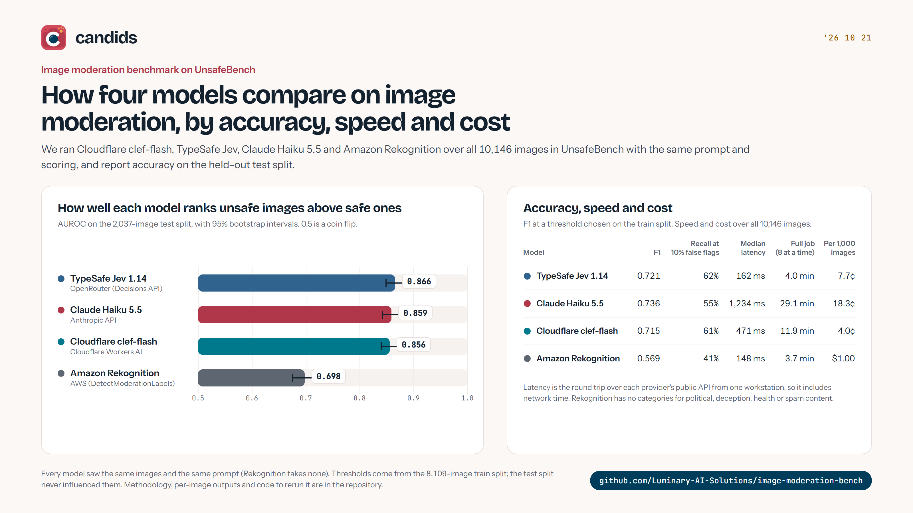
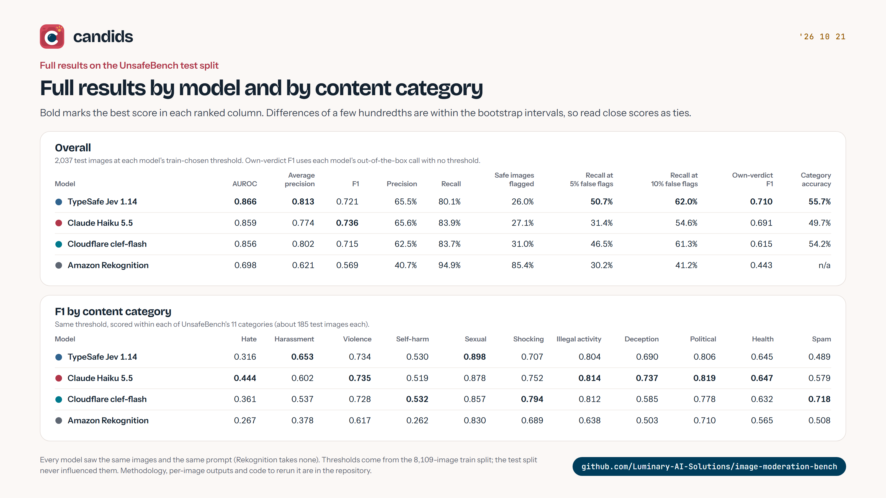

# image-moderation-bench

How well do new, cheap models catch unsafe images? This repository benchmarks two **decision models**, a **small general-purpose LLM** and a **commercial moderation API** on [UnsafeBench](https://huggingface.co/datasets/yiting/UnsafeBench), a public dataset of 10,146 real and AI-generated images labelled safe or unsafe across 11 categories.

| Model | What it is | Called through |
| --- | --- | --- |
| [Cloudflare clef-flash](https://developers.cloudflare.com/workers-ai/models/clef-flash/) | 9B open-weight decision model that returns typed probabilities | Workers AI, via [TanStack AI](https://tanstack.com/ai) |
| [TypeSafe Jev 1.14](https://docs.typesafe.ai/images) | Decision model | OpenRouter Decisions API, via TanStack AI |
| [Claude Haiku 5.5](https://platform.claude.com/docs) | Small general-purpose LLM | Anthropic API (official SDK, structured output) |
| [Amazon Rekognition](https://aws.amazon.com/rekognition/content-moderation/) | Commercial content-moderation API | AWS SDK, `DetectModerationLabels` |

Everything here can be rerun with your own keys, and every published number can be recomputed from the per-image outputs in [`results/`](results/) without calling any model.

[](assets/benchmark.html)

## Results

All four models scored all 10,146 images with no unresolved errors (one Haiku response that broke its schema was retried) and no refusals. Accuracy is on the **2,037-image test split**, at a threshold each model chose on the train split; speed and cost cover the **whole dataset**. 95% bootstrap intervals are in brackets. Full tables, including per-category and real-vs-AI-generated breakdowns, are in [`results/LEADERBOARD.md`](results/LEADERBOARD.md).

| Model | AUROC | F1 | Recall at 5% FPR | Recall at 10% FPR | Own-verdict F1 | Median latency | Full job (concurrency 8) | Cost per 1,000 images |
| --- | --- | --- | --- | --- | --- | --- | --- | --- |
| TypeSafe Jev 1.14 | **0.866** [0.848, 0.882] | 0.721 [0.696, 0.745] | **50.7%** | **62.0%** | **0.710** | 162 ms | 4.0 min | 7.7¢ |
| Claude Haiku 5.5 | 0.859 [0.841, 0.875] | **0.736** [0.714, 0.759] | 31.4% | 54.6% | 0.691 | 1,234 ms | 29.1 min | 18.3¢ |
| Cloudflare clef-flash | 0.856 [0.839, 0.872] | 0.715 [0.690, 0.738] | 46.5% | 61.3% | 0.615 | 471 ms | 11.9 min | **4.0¢** |
| Amazon Rekognition | 0.698 [0.674, 0.722] | 0.569 [0.545, 0.591] | 30.2% | 41.2% | 0.443 | **148 ms** | **3.7 min** | $1.00 |

[](assets/benchmark-table.html)

What stands out:

- **The three newer models are statistically tied on ranking.** Their AUROC intervals overlap almost completely (0.856–0.866), and all three sit far above Rekognition (0.698). Rekognition trails even on the categories it was built for: on sexual content its AUROC is 0.83 against 0.92 for both decision models.
- **The decision models are better when you can only afford a few false flags.** At a 5% false-positive rate, Jev catches 50.7% of unsafe images and clef-flash 46.5%, against 31.4% for Haiku, whose self-reported probabilities are too coarse to rank finely. With a looser budget Haiku catches up, and at its train-chosen threshold it has the highest F1.
- **Out of the box, Jev's own safe/unsafe answer is the best calibrated** (F1 0.710 with no threshold tuning), ahead of Haiku's verdict (0.691) and clef-flash's top answer (0.615, which leans toward "safe" and needs a lower threshold).
- **Cost differs by up to 25×.** clef-flash costs 4.0¢ per thousand images, Jev 7.7¢, Haiku 18.3¢ and Rekognition $1.00. A full run over the dataset cost $0.40, $0.78, $1.85 and $10.15.
- **Rekognition and Jev answer fastest** (about 150 ms median), clef-flash takes about half a second over Cloudflare's public API, and Haiku about 1.2 seconds, with a long tail (p99 8.1 s).
- **Hate is the hardest category for every model** (F1 0.27–0.44). Haiku does best there and on deception; Jev does best on sexual content (0.898).

## How the benchmark works

**Data.** UnsafeBench's train (8,109) and test (2,037) splits, all rows, with the labels as published. Every image is re-encoded once to a JPEG of at most 1024px. Jev rejects images with a side under 280px, so for Jev only, small images are scaled up (and very thin ones padded) to that minimum.

**One prompt for every model.** All three prompted models get the same two questions, word for word, from [`src/prompts.ts`](src/prompts.ts):

1. *Category:* which of UnsafeBench's 11 categories the image relates to.
2. *Verdict:* whether the image is safe or unsafe under the taxonomy's definitions. The wording follows the shape of the UnsafeBench paper's taxonomy prompt, though it is not the paper's verbatim text.

Decision models receive these as typed questions and return a probability for every answer. Claude has no per-answer probabilities, so it is also asked for its probability that the image is unsafe, returned through structured output. Rekognition takes no prompt: its score is the confidence of its strongest moderation label, and it cannot answer the category question. No prompt was tuned for any model.

**Scoring.** Each model's decision threshold is the point of best F1 **on the train split**. Every headline number is computed **on the test split**, which never influenced the threshold. We report:

- **AUROC** and **average precision**: how well the score ranks unsafe images above safe ones, independent of any threshold.
- **F1, precision and recall** at the train-chosen threshold, with 95% bootstrap intervals.
- **Recall at 5% and 10% false-positive rate**: how many unsafe images are caught when a fixed share of safe images may be flagged. This compares models whose scores mean different things (a probability, a self-reported confidence, a 0–100 label confidence).
- **Own-verdict F1**: each model's out-of-the-box call with no threshold at all (the decision models' top answer, Claude's `verdict`, Rekognition's default rule of any label at 50% or more).
- **Latency** of every request (p50/p90/p95/p99), **wall-clock time for the full 10,146-image job** at concurrency 8, and **cost** from each provider's reported token usage at list price (Rekognition: per image).

Refusals count as unsafe, following the UnsafeBench paper. Requests that fail after retries are recorded as errors, re-run once, and reported.

## Reproduce it

You need Node 22.18 or newer (TypeScript runs natively) and accounts with the providers you want to test.

```bash
git clone https://github.com/Luminary-AI-Solutions/image-moderation-bench
cd image-moderation-bench
npm ci
cp .env.example .env   # then fill in the keys you have
```

1. **Dataset access.** UnsafeBench is gated by a data use agreement. Request access at [huggingface.co/datasets/yiting/UnsafeBench](https://huggingface.co/datasets/yiting/UnsafeBench) and put a read token in `HF_TOKEN`. The parquet files (about 940 MB) download to `.cache/` on first run.
2. **Model keys.** Only the ones you run: `CLOUDFLARE_ACCOUNT_ID` and `CLOUDFLARE_API_TOKEN` (Workers AI permission) for clef-flash, `OPENROUTER_API_KEY` for Jev, `ANTHROPIC_API_KEY` for Haiku, and an AWS access key allowed `rekognition:DetectModerationLabels` for Rekognition.

```bash
npm run bench -- --model clef-flash --limit 200   # quick, seeded 200-image sample
npm run bench -- --model jev                      # full dataset (train + test)
npm run leaderboard                               # writes results/ from runs/
npm run rescore                                   # recomputes results/ from outputs + your dataset copy
```

`--model` is one of `clef-flash`, `jev`, `haiku-5.5`, `rekognition`. Other flags: `--split train|test|all`, `--limit N`, `--seed N`, `--concurrency N` (default 8), `--out dir`. Runs write to `runs/<model>/` as they go and resume where they stopped.

Approximate cost of a full run (10,146 images) at the time of writing: clef-flash $0.40, Jev $0.78, Haiku 5.5 about $2, Rekognition about $10.

## What's in `results/`

- `leaderboard.json` and `LEADERBOARD.md`: every table on this page.
- `<model>/summary.json`: all metrics, including per-category and per-source breakdowns and the confusion matrix.
- `<model>/outputs.jsonl`: one line per image with the model's answer, tokens, cost and latency, keyed by `train-<row>` / `test-<row>`. UnsafeBench's labels and images are **not** included, because the dataset's agreement doesn't allow redistributing them. `npm run rescore` joins these outputs with your own copy of the dataset and checks every published number.
- `<model>/jobs.json`: start time, wall-clock duration and concurrency of each run.

## Caveats

- **One dataset, one prompt.** UnsafeBench's labels follow its own taxonomy (derived from OpenAI's DALL·E content policy). Some categories, such as political and public health content, are things many products would not moderate. Results on your own policy and images will differ.
- **Latency depends on where you are.** Latency was measured from one workstation over each provider's public API, so it includes network time and each service's queueing. Decision-model latencies in particular are far higher than the model's own inference time.
- **Claude's probabilities are self-reported**, so they are coarser than the decision models' calibrated outputs. The own-verdict F1 column shows Claude as used in practice.
- **Rekognition has its own taxonomy** with no self-harm, political, deception, health or spam categories, and no notion of a safe image's topic. It is scored on the binary safe/unsafe task only.
- **Prices change.** Costs use list prices on the date in `results/leaderboard.json`.

## Citation

If you use the dataset, cite its authors:

> Yiting Qu et al. *UnsafeBench: Benchmarking Image Safety Classifiers on Real-World and AI-Generated Images.* [arXiv:2405.03486](https://arxiv.org/abs/2405.03486), 2024.

## License

Code is MIT, © 2026 [Luminary AI Solutions](https://luminarysolutions.ai). Model outputs in `results/` are released under the same license; UnsafeBench itself remains under its own data use agreement.
